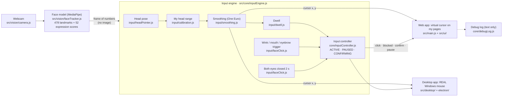

# How it works

The whole system in one picture. Each box is one file (or folder), and the arrows show what flows between them.
Only the first two boxes touch the camera or MediaPipe; everything after them is plain numbers and pure functions,
which is why the whole pipeline can be tested without a webcam.

## The steps, one by one

1. **Camera → face model.** `faceTracker` runs MediaPipe FaceLandmarker in VIDEO mode on this device.
   Out comes a frame of numbers: 478 face points and 52 expression scores (for example `eyeBlinkLeft`).
   The image itself is never stored or sent.
2. **Head pose** (`headPointer`): yaw and pitch = how far the nose tip is from the centre of the face,
   divided by the face size. Dividing by face size means leaning closer to the camera does not move the cursor.
3. **My head range** (`calibration`): maps my comfortable head range to the whole screen
   (auto-centred in the first second; "Calibrate" records the centre and 4 corners).
4. **Smoothing** (One Euro filter): steady when I hold still, fast when I turn my head.
5. **Click signals.**
   - *Wink* (default): one eye closed, the other open, held 1.5 s. Left = click, right = right click.
     Normal blinks (both eyes, short) never click.
   - *Mouth / eyebrows* (optional): debounce + hysteresis + refractory time, so one gesture = one click.
   - *Dwell* (optional): hold the cursor still on a button for 1.2 s.
6. **Pause:** both eyes closed for 2 s toggles PAUSED. Nothing is clicked while paused.
7. **Input controller** (ACTIVE / PAUSED / CONFIRMING): the only place that says yes or no to a click.
   Risky buttons (`data-risk="high"`) need a second, *different* signal; a timeout cancels.
   Real mouse and keyboard clicks also go through it, so there is no side door around these rules.
8. **Output.**
   - Web app: a virtual cursor inside my own pages (a browser cannot move the real mouse).
   - Desktop app: the same engine drives the real Windows mouse (`electron/mouse.cjs`), with a click lock
     so the cursor stays still while a wink is held (`src/desktop/cursorGate.js`).
9. **Debug log** (`core/debugLog.js`): short text events (clicks, pauses, errors, settings changes) for
   "Copy debug info" in Settings. No images, landmarks or expression scores.

## If something breaks, where do I look?

| What I see | Most likely place |
| --- | --- |
| "I can't see your face" / camera errors | `src/vision/`, lighting, camera permission |
| Cursor goes the wrong way or does not reach a corner | `input/headPointer.js`, `input/calibration.js` |
| Cursor shakes or lags | `input/smoothing.js` (Settings → Cursor smoothing) |
| Blinks or talking cause clicks | `input/faceClick.js` (thresholds, hold time) |
| A click was ignored | `core/inputController.js` (was it PAUSED or CONFIRMING?) → check "Copy debug info" |
| Desktop: real mouse does not move | `electron/mouse.cjs` (Windows only) |
